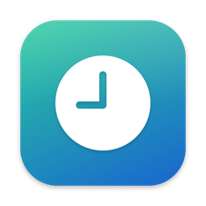
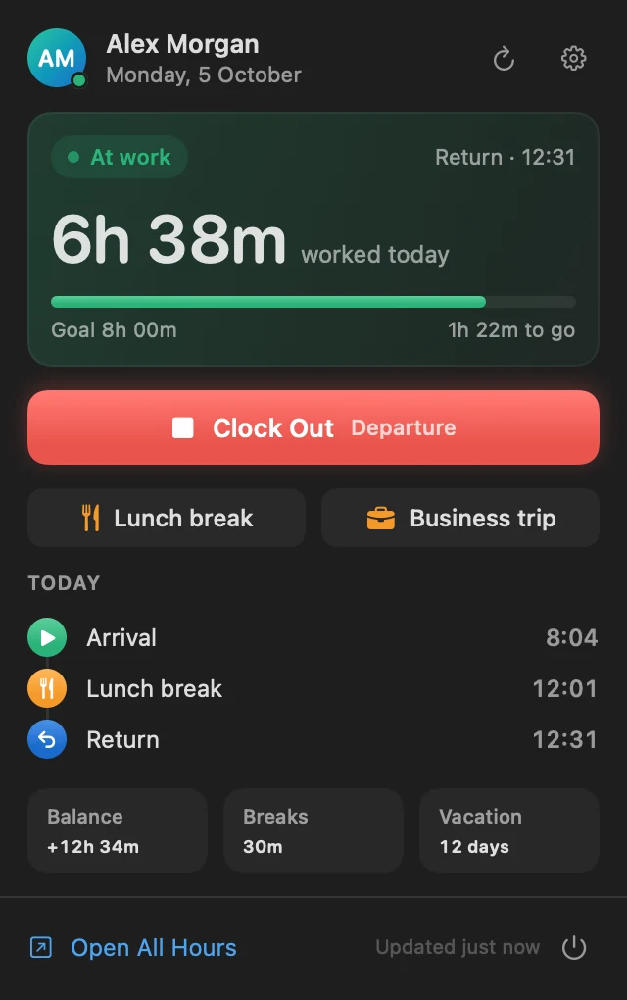

<p align="center">
  
</p>

<h1 align="center">All Hours Bar</h1>

<p align="center">
  Your <a href="https://www.allhours.com">All Hours</a> attendance in the Mac menu bar.<br>
  See whether you're clocked in, clock in or out with one click, and get a reminder when you forget.
</p>

<p align="center">
  <a href="https://github.com/adnan-smlatic/allhours-bar/releases/latest/download/AllHoursBar.dmg"><b>Download for Mac</b></a>
  · <a href="https://adnan.si/allhours-bar/">Website</a>
  · macOS 14+ · Apple Silicon &amp; Intel
</p>

<p align="center">
  
</p>

> **Unofficial.** All Hours Bar is an independent project. It isn't affiliated with, endorsed by or supported by All Hours or Spica International.

## What it does

- **Status at a glance.** The menu bar shows a clock that fills in while you're at work, plus the time worked today. A cup means you're on a break.
- **One-click clocking.** You get your company's own clock buttons (clock in, clock out, break, business trip, work from home, …), with **Undo** for 10 seconds.
- **Today's numbers.** Time worked against today's goal from All Hours, every clocking, breaks, your overall balance and vacation days left.
- **Reminders.** On weekdays you get a notification if your Mac wakes or unlocks and you haven't clocked in yet. You get another if you're still clocked in after a time you pick. Both have the clock button right in the notification.
- **Updates.** Once a week the app checks for a new version. A new version shows up in the menu, or installs itself the next time the app quits if you turn that on in settings.

## Install

1. Download [`AllHoursBar.dmg`](https://github.com/adnan-smlatic/allhours-bar/releases/latest/download/AllHoursBar.dmg), open it, and drag **All Hours Bar** into **Applications**.
2. Open the app. It isn't notarized by Apple, so macOS blocks the first launch. Go to **System Settings › Privacy & Security** and click **Open Anyway**. You only do this once: updates install without it.
3. Click the clock in the menu bar and choose **Sign in with All Hours**.
4. Optional: in the app's settings, turn on **Open at login**.

## Signing in

**Sign in with All Hours** opens the real All Hours login page (`login.spica.com`) in a small window.
It uses the same OAuth 2.0 authorization-code + PKCE flow that pro.allhours.com uses, so any login method your company has works, and the app never sees your password.

*Other ways to sign in* in the app covers the two flows All Hours documents for integrations:

| Option | What you need |
| --- | --- |
| Email & Password | A client ID (and secret, if required) issued by All Hours for the OAuth "resource owner" flow. |
| API Key | A key an admin creates in **Settings › Advanced › API**. Your email is used to find your user. |

## Privacy

- The session (and, for the fallback options, the credentials you type) is stored in the macOS Keychain. Settings stay in your user defaults.
- The app talks to `login.spica.com` and `api4.allhours.com`, and once a week to GitHub to check for updates (you can turn that off in settings). Nothing about you is sent. There are no analytics and no servers of its own.
- It only offers the clock buttons your company already allows in the All Hours web clock.

## Build from source

Requires Xcode 16 or newer.

```sh
git clone https://github.com/adnan-smlatic/allhours-bar.git
cd allhours-bar
./scripts/build.sh            # → build/All Hours Bar.app
./scripts/build.sh --install  # also installs to /Applications and launches it
```

Builds are ad-hoc signed by default, so no Apple account is needed.
To sign with your own team so Keychain access survives rebuilds, copy `Config/Signing.local.xcconfig.example` to `Config/Signing.local.xcconfig` (git-ignored) and fill in your team ID.

### Project layout

| Path | What's there |
| --- | --- |
| `AllHoursBar/API` | OAuth (`TokenProvider`, `WebSignIn`), the REST client and response models |
| `AllHoursBar/Store` | `AttendanceStore` (state, worked-time maths), reminders, formatting |
| `AllHoursBar/Views` | SwiftUI: menu bar label, dashboard, sign-in, settings |
| `AllHoursBar/Debug` | Demo mode for trying the UI and making screenshots (Debug builds only) |
| `AllHoursBar/App` | App entry point and `Updates` (Sparkle) |
| `scripts` | Build, release signing, DMG and appcast packaging, icon rendering |
| `website` | The project website (Next.js, static export) |

### API

Everything mirrors what the All Hours web clock does, against `https://api4.allhours.com/api/v1`:

| What | Endpoint |
| --- | --- |
| Your status and clock buttons | `GET Clocks/Web` |
| Clock in / out / break | `POST Clockings/Authentic` with `{UserId, ClockingDefinitionId, Origin: 2}` |
| Undo | `DELETE Clockings/{id}/Undo` |
| Today's clockings | `GET Clockings/Personal?dateFrom=…` |
| Button types (arrival, departure, …) | `GET ClockingDefinitions/Personal` |
| Balance, today's remaining time, vacation | `GET Presence/{userId}` |

### Demo mode and screenshots

Debug builds accept launch arguments that load sample data instead of signing in:

```sh
APP="build/DerivedData/Build/Products/Debug/AllHoursBar.app"
open "$APP" --args --demo                                   # menu bar with sample data
"$APP/Contents/MacOS/AllHoursBar" --demo --demo-window --demo-dark \
  --demo-snapshot=dashboard.png                             # renders a 2× PNG and quits
```

Add `--demo-settings`, `--demo-signed-out` or `--demo-break` for the other screens, and `--demo-light` for Light Mode.
Setting `ALLHOURS_DUMP_DIR` in a Debug build saves every API response there.

### DMG

```sh
./scripts/make-dmg.sh   # → dist/AllHoursBar.dmg (universal)
```

The install window background is drawn by `scripts/dmg/background.swift`, and `dmgbuild` (installed into `build/dmg-venv`) lays out the window.
Without the release keys the app in it is ad-hoc signed and no appcast is made.

### Releasing

Updates use [Sparkle](https://sparkle-project.org). Installed copies read `appcast.xml` from the latest GitHub release once a week, and only install an update when both that file and the DMG are signed with the release key.

The release keys live in `~/.config/allhours-bar-release` (back that folder up; its `README.txt` says what's in it):

- a keychain with the self-signed **All Hours Bar** code signing certificate. Every release is signed with it, so Sparkle can also check an update's code signature, and no personal details end up in the download. It doesn't stop macOS asking for the login password once after each update before the app can read its Keychain item: without an Apple Team ID, the Keychain ties the item to the exact build. Only a Developer ID certificate fixes that.
- `sparkle-ed25519.key`, the Sparkle update key. Its public half is `SUPublicEDKey` in `Config/Info.plist`. Without it, installed copies can't be updated anymore.

To publish a release, bump `MARKETING_VERSION` and `CURRENT_PROJECT_VERSION` (Sparkle compares the build number), then:

```sh
NOTES=notes.md ./scripts/make-dmg.sh     # dist/AllHoursBar.dmg + dist/appcast.xml, notes shown in the update window
gh release create v1.2.0 dist/AllHoursBar.dmg dist/appcast.xml --title "All Hours Bar 1.2.0" --notes-file notes.md
```

### Website

```sh
cd website
bun install
bun run dev       # live-reloading dev server at http://localhost:4170
bun run build     # static export in website/out
bun run preview   # serves website/out at http://localhost:4173 and opens it
```

Open the built site through `bun run preview` or any static host. Opening `out/index.html` straight from Finder doesn't work, because the page loads its CSS and fonts from site-root paths (`/_next/…`).

The site is served from https://adnan.si/allhours-bar/. `.github/workflows/website.yml` redeploys it when `website/` changes on `master`: it connects to the server with the `DEPLOY_SSH_KEY` secret, which can only run the server's deploy script (pull, build with `BASE_PATH=/allhours-bar`, publish).

## License

[MIT](LICENSE) © [Adnan Smlatić](https://adnan.si)
